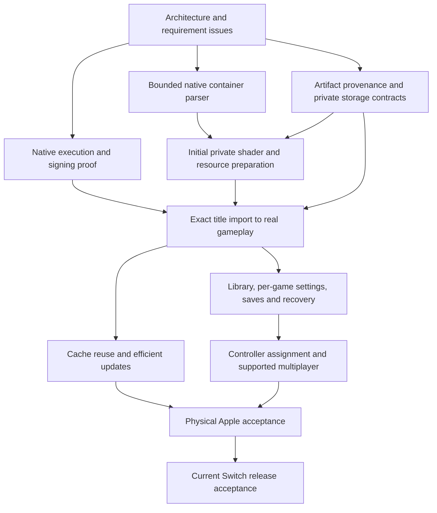

# Content-free Switch launcher: architecture and release gates

Status: proposed architecture, execution gate blocked; no public launcher release is ready.
Parent: [#34](https://github.com/monkeorg/MacNativeGames/issues/34).
Source baseline: `c4552cd593bc42e5f9d3d5e38d6dc3465e433763`.
Work belongs to `feat/content-free-launcher`, separately from the local TOTK app.

## Decision

Keep the native, ahead-of-time ARM64 direction and existing checked rewriter,
loader, host services and Metal implementation. Do not substitute a CPU emulator,
JIT, streamed session or mock runtime. Do not alter the working TOTK target or
its bundle identity. There is currently **no demonstrated execution path** for
user-imported game code in a content-free public iPad app.

The existing iOS loader remaps signed executable sections from its own Mach-O;
`ios/tools/gen_embed.py` emits those sections from private rewritten modules.
The read-only code, writable game data, generated shaders, fonts and icons are
all relevant to artifact purity. Moving only RomFS into Documents does not solve
this. See [execution investigation](content-free-execution.md).

Separate three outputs:

1. **Public host**: original implementation and licensed dependencies only; system
   fonts and original UI artwork. No Nintendo-derived executable or data payloads.
2. **Private preparation store**: user-selected originals, exact-version manifests,
   prepared resources and caches. Never uploaded or committed. A cache is not a
   supported executable merely because preparation succeeded.
3. **Execution evidence**: signed native fixture first, then an exact title/version
   on actual Apple hardware, with gameplay and recovery evidence. A private
   Mac-built/signed game app is a possible intermediate experiment, not acceptance
   of standalone on-iPad preparation or a content-free public app.

No change to CONTRIBUTING's execution policy is proposed in this checkpoint.
If the required native execution route cannot satisfy iPadOS signing restrictions,
that is a product decision blocker, not permission to silently change architecture.

## Boundaries and ownership

| Component | Contract | Reuse / gate |
|---|---|---|
| Library | Local stable title/version identity; preparation state distinct from compatibility and Play eligibility | New host UI only after execution contract; no fabricated supported titles |
| Import | Bounded container reads, validated filenames/ranges; user-selected security-scoped access | Reuse parser semantics in `extract_exefs.py`; Python is a reference, not an iOS shipping dependency |
| Preparation | Immutable versioned generations; atomic publication, cancellation and resumable/retryable failures | Current verified input hashes and existing build fingerprints; preserve previous generation |
| Runtime | Checked AOT modules, services and Metal backend for an exact supported profile | Gate: import-to-execution proof; current loader embeds game bytes |
| Settings/input | Per-title validated preferences and explicit live/startup capabilities | Existing launcher settings, overlay and controller maps; no universal capability claims |
| Saves | Per-title/profile isolation, account identity, pre-Play mutation, staged replacement/backups/rollback | Reuse `save_store.m`; semantic editor stays disabled without exact format validation |
| Updates/cache | Reuse unchanged verified resources; distinguish app/recipe/game/cache identities | Reuse existing fingerprints; no app update rewrites user saves |
| Multiplayer | Per-title native services plus independently assigned players/controllers | Mario Kart has no verified profile or session; UI assignment alone cannot pass |
| Evidence | Portable synthetic checks, public-artifact provenance, Apple build and physical session records | Keep generated/private artifacts outside Git; never equate extraction or HUD with gameplay |

## Gate order

Independent parser/provenance checks may proceed while B is blocked. Product UI
and game preparation must not present an imported container as playable without B
and E. No speculative second engine, game profile, compatibility list, updater or
save editor is introduced to fill a roadmap box.

## Current release requirement matrix

All acceptance remains open unless linked evidence says otherwise. Historical
TOTK app results do not validate this separate launcher.

| Requirement | Required evidence | Dependency / present status |
|---|---|---|
| Content-free public IPA | File inventory and reviewed source/build provenance; no derived game sections/resources; installed artifact hashes | Public host target not built; checker alone cannot certify provenance |
| Standalone native execution | Signed native fixture and exact-version imported title enters real gameplay on iPad | Blocked on Apple signing/loading feasibility and private local inputs |
| Local import/setup | Real security-scoped folder and declared supported container import, explicit failures, bounded progress/cancel | Native parser first; decryption/update/shader pipeline still needed |
| Base/update/DLC identity | Exact title/version dependencies, integrity verification and mismatch refusal before publication | Native import and private preparation contract |
| Library/onboarding | Accessible iPad touch/controller navigation, honest unsupported/missing-input states | Runtime capability contract before Play |
| Per-game settings/overlay | Persistence and actual live/startup behavior per verified profile; no input underneath overlay | Reuse existing settings only after host integration |
| Saves/editor | Roundtrip bytes, identity, failed replacement rollback, physical load; editor only with independently validated format | Per-game store and exact format gate |
| Preparation/recovery | Fault injection, restart/cancel, unchanged previous generation and saves, provider loss | Versioned staging contract and device filesystem checks |
| Efficient updates | Same content not recopied; correct invalidation on recipe/game changes; measured transfer/storage | No claim from drawable or file count alone |
| Shaders/graphics | User-derived private preparation, no bundled translated game shaders, correct real scenes | Native iOS translator and execution proof |
| Multiplayer | Mario Kart exact-version profile plus actual local multi-player session, controller disconnect/reassign | No Mario Kart runtime integration or supported version yet |
| Diagnostics/performance | Native-frame attribution, memory/thermal/storage evidence, bounded private logs | Physical hardware; stable 60 FPS is not claimed |
| Apple acceptance | Full build/sign/install, artifact check, gameplay, lifecycle, recovery and update matrix | Xcode, signing, private inputs and devices unavailable in cloud |

The mod manager (#35), Wii U and future console backends are excluded from every
release dependency and finish gate. Their existing backlog is not an implementation
assignment.

## Local acceptance order

1. Preserve the working TOTK checkout/app, private profile backup and signing identity.
2. Compile/run the original-source native execution fixture under the intended
   distribution/signing model. Record SDK/OS, entitlements, build SHA and permission
   failures. Do not extrapolate from a developer-debugger session to a released IPA.
3. Resolve the content-free import execution mechanism for one exact title/version;
   audit the final public package and private preparation boundary.
4. Demonstrate local import, preparation, entry into gameplay, relaunch and interrupted
   setup with the previous generation/saves preserved.
5. Integrate and physically verify library, settings/overlay, save roundtrips, cache
   reuse/update invalidation, diagnostics and lifecycle.
6. Add and verify Mario Kart's native profile/services and a real multiplayer session.
7. Record the full requirement matrix. Leave every unexecuted gate open. No merge or
   release is authorized by this plan.

## Tracked implementation work

| Issue | Outcome | Required predecessors |
|---|---|---|
| [#38](https://github.com/monkeorg/MacNativeGames/issues/38) | Native execution and signing proof, then exact-title gameplay | Architecture |
| [#36](https://github.com/monkeorg/MacNativeGames/issues/36) | Bounded native container import | Architecture; #38 before gameplay claims |
| [#39](https://github.com/monkeorg/MacNativeGames/issues/39) | Public provenance and recoverable private generations | Architecture; #38 before runtime integration |
| [#37](https://github.com/monkeorg/MacNativeGames/issues/37) | Library, per-game settings, saves, accessibility | #38, #36, #39 |
| [#41](https://github.com/monkeorg/MacNativeGames/issues/41) | Private shader preparation and efficient updates | #36, #39; initial resources before #38 gameplay; update validation after it |
| [#40](https://github.com/monkeorg/MacNativeGames/issues/40) | Mario Kart multiplayer and physical release acceptance | #38, #37, #41 |

This issue split groups related work; the requirement matrix above remains the
finish gate. None of these issues is complete at the architecture checkpoint.
